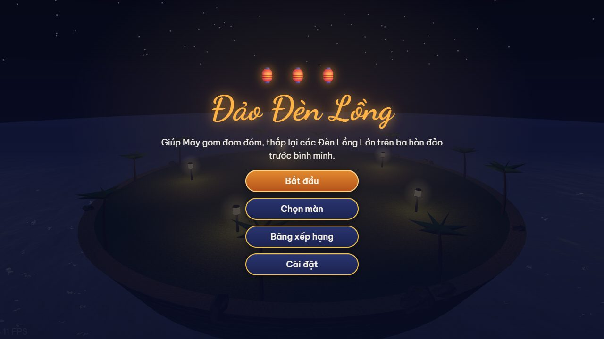
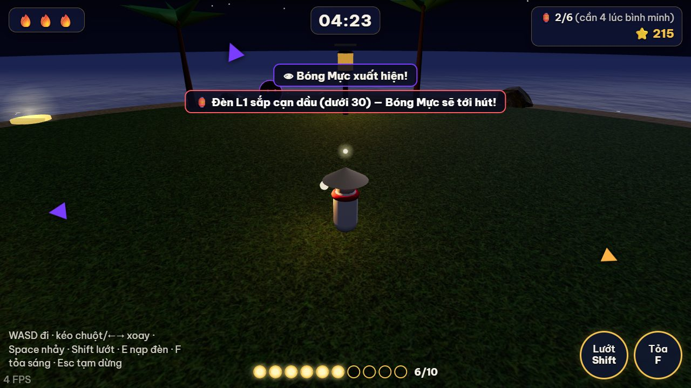
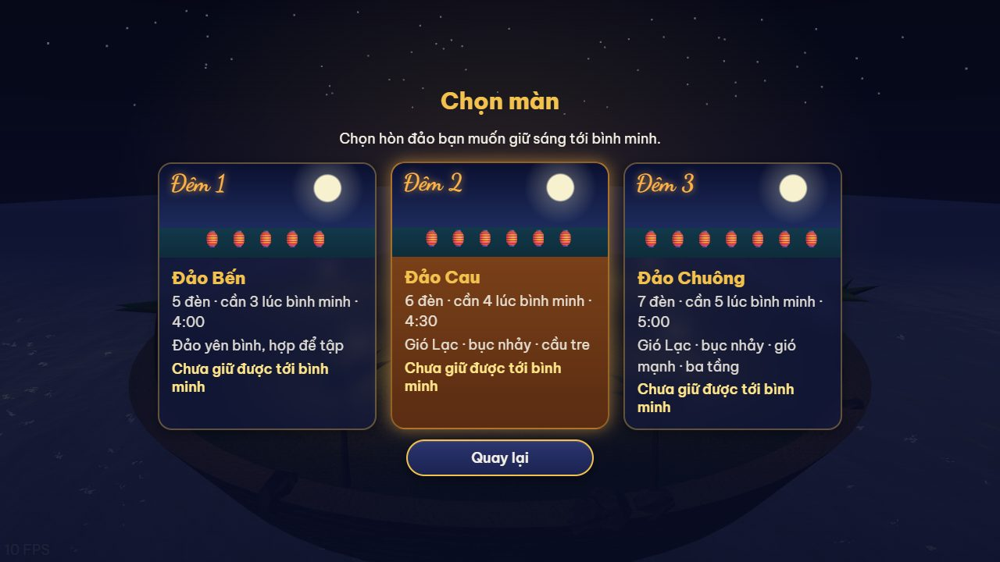
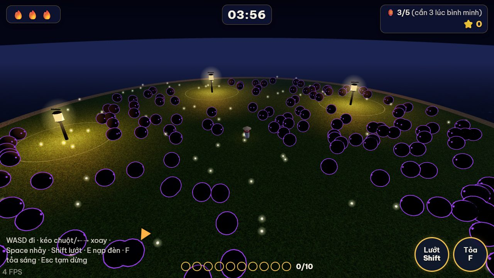
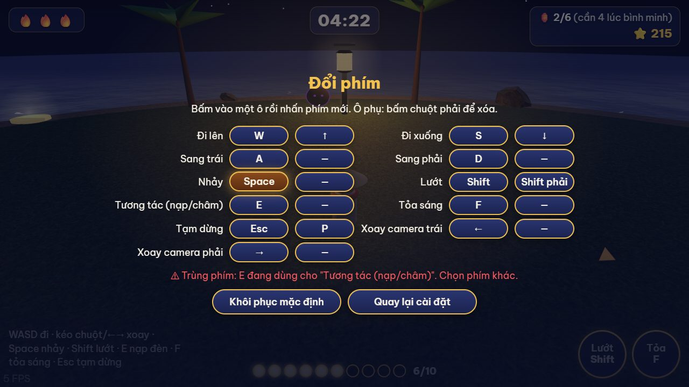
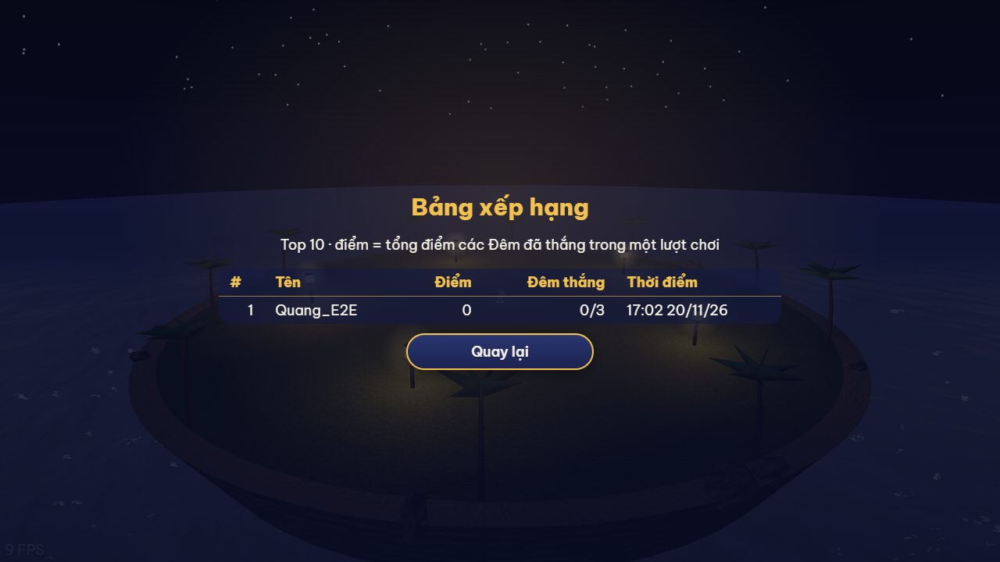

# Đảo Đèn Lồng — v1.0.0

> 🎬 **Video demo:** [demo.mp4](https://github.com/Quang-safjl/K5-L3A-DAY12-NguyenDinhQuang-2A202603620-AI-SDLC-Dao-Den-Long/releases/download/v1.0.0/demo.mp4)
> Nguyễn Đình Quang · 2A202603620 · K5-L3A · Day 12 AI SDLC · Đề bài gốc: [docs/lab/](docs/lab/README.md)

Game 3D góc nhìn thứ ba chạy trên trình duyệt: **Mây**, người giữ đèn nhỏ tuổi, gom đom đóm để thắp và **giữ sáng** các Đèn Lồng Lớn trên ba hòn đảo cho tới bình minh, né Bóng Mực trong sương đen. Có chế độ headless tất định theo Test Contract v1.3 (dùng để chấm tự động), benchmark, soak test và bảng xếp hạng cục bộ.

| | |
|---|---|
|  |  |
|  |  |
|  |  |

## Yêu cầu hệ thống
- **Node.js ≥ 18** (đã thử Node 24). Không có dependency npm, không cần `npm install`.
- Trình duyệt hỗ trợ **WebGL2**: Chrome/Edge/Chromium (khuyến nghị), Firefox. Benchmark cần Chrome, Edge hoặc Chromium.
- Windows 10/11, macOS hoặc Linux. Không cần Internet (three.js r160 đã kèm trong `vendor/`).
- Máy tham khảo (đo `bench.json`): Intel Core i5-1235U, GPU tích hợp Intel UHD, RAM 8 GB, Windows 11.

## Cài đặt và chơi (3 lệnh)
```bash
git clone https://github.com/Quang-safjl/K5-L3A-DAY12-NguyenDinhQuang-2A202603620-AI-SDLC-Dao-Den-Long.git dao-den-long
cd dao-den-long
node serve.js            # rồi mở http://localhost:8000
```
Bản phát hành: tải `dao-den-long-v1.0.0.zip` ở [Releases](../../releases), giải nén, chạy `node serve.js` trong thư mục đó.
Đừng mở `index.html` trực tiếp hoặc dùng `python -m http.server` (trên Windows có thể trả `.js` sai kiểu → màn hình đen; và bảng xếp hạng cần `serve.js` để lưu xuống đĩa).

## Điều khiển (mặc định — đổi được trong Cài đặt → Đổi phím)
| Phím | Hành động |
|---|---|
| W A S D / ↑ ↓ | Đi (theo hướng camera) |
| Kéo chuột / ← → | Xoay camera |
| Space | Nhảy |
| Shift | Lướt |
| E | Nạp đom đóm / châm dầu cho đèn gần nhất |
| F | Tỏa Sáng (xua Bóng Mực, Gió Lạc) |
| Esc / P | Tạm dừng (Tiếp tục / Chơi lại Đêm / Cài đặt / Về menu) |

**Menu:** Bắt đầu (chơi từ Đêm 1) · **Chọn màn** (mở sẵn cả 3 Đêm, lưu điểm cao nhất) · **Bảng xếp hạng** · Cài đặt.

## Luật & cách tính điểm (xem `game.contract.json` v1.3)
- 3 Đêm: **Đảo Bến** (5 đèn, 4 phút) → **Đảo Cau** (2 đảo, cầu tre, bục nhảy, Gió Lạc, 6 đèn, 4:30) → **Đảo Chuông** (3 tầng, gió mạnh, 7 đèn, 5 phút).
- **Mục tiêu: giữ đảo sáng tới bình minh.** Hết giờ mà còn sống và ≥ 60 % đèn đang sáng (3/5, 4/6, 5/7) thì thắng.
- Đèn sáng có **dầu 100**, hao 1/giây. Bấm **E** cạnh đèn để thắp (10 đom đóm; đèn từng sáng chỉ cần 5) hoặc châm dầu (+10 mỗi đom đóm). Dầu dưới 30: đèn nhấp nháy, **mất vùng an toàn**, Bóng Mực tới hút dầu.
- Sức chứa 10 + 2 mỗi lần thắp thành công (tối đa 20). Tỏa Sáng tốn 3 đom đóm, choáng Bóng Mực trong 5 m.
- Điểm: +5 mỗi đom đóm nạp, +100 thắp lần đầu, +40 thắp lại, +5/+15 mỗi Bóng trúng Tỏa Sáng; thắng: mỗi đèn sáng +50 + dầu còn lại, mỗi Ngọn Lửa +50.

## Bảng xếp hạng
Thua ở bất kỳ Đêm nào hoặc tới **Bình Minh** (thắng Đêm 3) → nhập tên 3–12 ký tự (chữ, số, `_`; chữ tiếng Việt có dấu cũng được). Lưu **top 10** ở `data/leaderboard.json` (còn sau khi tắt/mở lại). Điểm = tổng điểm các Đêm đã thắng trong lượt chơi; bằng điểm thì ai đạt trước đứng trên.
```bash
node serve.js --export-leaderboard out.json   # → {"entries":[{name, score, nights_won, achieved_at, seed}, ...]}
```

## Dễ tiếp cận (Cài đặt)
- **Đổi phím** cho mọi hành động (2 phím mỗi hành động), báo khi trùng phím, nút **Khôi phục mặc định**, tự lưu.
- **Phụ đề & chỉ báo hình ảnh**: Bóng Mực xuất hiện (kèm mũi tên tím ở mép màn hình chỉ hướng), gió sắp thổi, 10 giây cuối, đèn sắp cạn dầu (< 30), bị đánh, Gió Lạc cướp đom đóm.
- **Giảm chuyển động**: tắt rung camera, chớp màn hình và mọi nhấp nháy (mặc định theo cài đặt hệ điều hành).
- **Chữ lớn ×1.25**; cỡ chữ nhỏ nhất của giao diện là 18 px ở 1280×720.
- **Bảng màu dễ phân biệt** (mù màu), âm lượng, độ nhạy chuột, đồ họa cao/thấp.

## Test, headless, benchmark, soak
```bash
npm test                                              # 73 test node:test (gọi headless.js thật), Phase 1–4
node headless.js --seed 1 --night 2 --ticks 600 --out out.jsonl
node bench.js --seed 42 --duration 30 --out bench.json   # mở cửa sổ Chrome/Edge 1280×720, đo 30 s, tự thoát mã 0
node soak.js  --seed 7  --nights 10   --out soak.json    # 10 Đêm liên tiếp trong 1 tiến trình
bash scripts/proof.sh phase-4                         # sinh lại toàn bộ bằng chứng (BENCH=1 để chạy cả bench)
python scripts/ui_smoke.py "<đường dẫn chrome>"       # (tùy chọn, cần: pip install playwright) 44 kiểm tra giao diện
```
- **Benchmark**: cảnh chuẩn Đêm 1, 200 Bóng Mực wander + 100 đom đóm, L1–L3 sáng, camera bay vòng R 30 m, Y 15 m, 15 s/vòng; 3 s khởi động rồi đo. **Vsync tắt được** bằng cờ Chromium `--disable-gpu-vsync --disable-frame-rate-limit` (`vsync_off: true`). Không tìm thấy trình duyệt thì chỉ định `--browser "<đường dẫn>"` hoặc biến `CHROME`. `peak_mem_mb` = tổng RAM của mọi tiến trình trình duyệt của lần chạy.
- Kết quả đã commit: [bench.json](bench.json) · [soak.json](soak.json) · báo cáo đầy đủ [docs/proof/phase-4/test-report.txt](docs/proof/phase-4/test-report.txt).

Test Contract v1.3: [game.contract.json](game.contract.json) · Thay đổi: [CHANGELOG.md](CHANGELOG.md) · Quyết định thiết kế: [ADR 0001](docs/adr/0001-lantern-fuel-and-dawn-win.md), [ADR 0002](docs/adr/0002-benchmark-soak-release.md)

## Cấu trúc
```
src/sim.js          luật chơi thuần, tất định (dùng chung cho game, headless, bench, soak)
src/maps.js         bản đồ chuẩn 3 đêm
src/bench.js        cảnh benchmark chuẩn + công thức số đo
src/leaderboard.js  bảng xếp hạng (kiểm tra, sắp xếp, top 10)
src/keybinds.js     đổi phím
src/game3d.js       hiển thị Three.js + menu/HUD/điều khiển (không chứa luật)
src/audio.js        âm thanh tổng hợp WebAudio
headless.js · bench.js · soak.js · serve.js   CLI
tests/              test node:test
assets/ vendor/     texture, font, three.js (xem CREDITS.md)
scripts/            proof.sh, package.sh, ui_smoke.py, autoplay.js (bot), hooks/
docs/notes/         yêu cầu + giả định từng phase, nhật ký AI, retro
docs/proof/         bằng chứng từng phase · docs/adr/ quyết định thiết kế
AGENTS.md, CLAUDE.md, .claude/   harness AI (hướng dẫn agent, hook Stop, skill verify-phase)
```

## Sáng tạo của tôi
Tất cả chỉ ở phần hiển thị; output headless giữ nguyên (test P4-02 so từng byte với Phase 3) và đều tắt trong cảnh benchmark.
- **Đảo sáng dần**: ánh sáng môi trường ấm dần theo số đèn đang sáng; đèn trên nón Mây sáng hơn khi mang nhiều đom đóm. — *bằng chứng: ảnh `play.jpg`*
- **Cảnh có asset thật** (CC0): mặt biển phản chiếu, trời sao + trăng, cây dừa, đá, lan can cầu tre, chuông vàng trên tháp, đèn lồng giấy có quầng sáng. Tắt "Đồ họa cao" cho máy yếu. — *ảnh `menu.jpg`, `play.jpg`*
- **Chọn màn** với thẻ thông tin từng đảo và điểm cao nhất; menu có cảnh Đảo Bến quay chậm phía sau. — *ảnh `levels.jpg`, UI smoke*
- **Rung camera + chớp đỏ khi bị đánh, chớp vàng khi Tỏa Sáng** (tắt bằng Giảm chuyển động). — *UI smoke "Bị đánh: chớp màn hình"*
- Lời dẫn của **Ông Đăng** khác nhau mỗi Đêm; lá bay báo gió ở Đêm 3; bộ đếm FPS góc dưới trái.

## Tài liệu
- Yêu cầu, giả định & đánh giá: [Phase 1](docs/notes/phase-1.md) · [Phase 2](docs/notes/phase-2.md) · [Phase 3](docs/notes/phase-3.md) · [Phase 4](docs/notes/phase-4.md)
- Bằng chứng: [Phase 1](docs/proof/phase-1/README.md) · [Phase 2](docs/proof/phase-2/README.md) · [Phase 3](docs/proof/phase-3/README.md) · [Phase 4](docs/proof/phase-4/README.md)
- Nhật ký AI: [docs/notes/ai-log.md](docs/notes/ai-log.md) · Retro: [docs/notes/retro.md](docs/notes/retro.md)
- Giấy phép: [LICENSE](LICENSE) (MIT) · Nguồn asset: [CREDITS.md](CREDITS.md)
